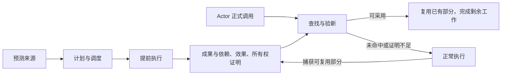

# Pi 投机执行与缓存复用

纯 Pi 扩展：提前执行可能需要的工作，让正式工具调用复用已经完成的部分，保留原工具的输出和副作用语义。

## 主线架构

**投机决定提前做什么，缓存复用决定已有工作能否使用。** 两者由同一运行时编排；缓存既接收投机产物，也接收正常执行留下的可复用成果。



- **投机生产**：Drafter、PatternAware 和 Actor 信号提供候选，计划与调度负责依赖、预算、并发和取消，执行后端负责受控执行。提前准备已观察的子操作也属于这一层。预测观测只用于私有续推，Actor 历史只接收真实结果。
- **缓存复用**：保存、发现并验证工具结果、输入、纯子计算及受支持的进程状态。正式调用按实际操作、依赖、效果和当前所有权采用成果，继续执行剩余部分；工具名称和预测来源不授予复用权限。

预测匹配、成果有效性和实际消费分别记账。关闭投机后，正常调用仍可积累并使用缓存；预测失配也不自动作废独立有效的成果。效果只提交一次，消费期间保留资源，取消、淘汰和关闭按所有权释放。收益只计实际消费的计算，等待和未消费的工作另行统计。

源码主线：[Host 接入](./src/agent-integration.ts) → [运行时编排](./src/runtime-engine.ts) → [统一执行入口](./src/tool-execution-gateway.ts)。[执行世界](./src/execution-world.ts)提供捕获、验证和提交契约；[资源版本](./src/resource-version.ts)与[存储](./src/reuse-store.ts)管理可复用成果及证明。

## 使用

需要 Node.js ≥ 22.19；使用未修改的 Pi，当前兼容验证基线为 `0.84.1`。

```sh
pi install git:github.com/xchang1121/pi-speculative-action@speculative-action
pi
```

运行 `/speculative-action`，调整开关和预测来源后选择 **Apply changes**。

| 开关 | 默认值 | 职责 |
| --- | --- | --- |
| **Speculative production** (`enabled`) | 关闭 | 启用额外的提前生产，包括调用预测、流式预览和已观察操作的准备。 |
| **Cache & reuse** (`reuseEnabled`) | 开启 | 捕获并采用可复用成果；关闭后停止缓存采用及新的提前生产。 |

两个开关都保留实际调用的观察与模式学习。`tools` 和各预测来源开关只筛选提前生产，不限制其他工具复用合格成果。

全局配置位于 `<agent-dir>/speculative-action.json`，项目配置位于 `.pi/speculative-action.json`。本地开发可用 `pi -e /absolute/path/to/pi-speculative-action` 加载。

Linux / WSL 2 需在扩展目录运行 `npm run setup:linux`，升级后重新运行；WSL checkout 放在 Linux 原生文件系统。Windows x64 使用随包提供的本地 NTFS 对象租约，无需另行编译。

## 支持边界

- **文件与计算**：通过显式操作绑定共享输入和纯子计算；仅声明工具“只读”不能授权缓存其完整结果。写入通过工作区事务隔离、验新并提交。
- **Linux 进程**：已验证范围为 x86-64、同一 ext4 挂载和 UTF-8 路径，支持合格 Bash 分支、已观察子操作及可封存的单线程进程。检查点跨进程恢复还要求同一次系统启动、同一 Pi 会话、工作区和原缓存位置。
- **平台范围**：Windows 支持本地 NTFS 文件资源与私有工作区。任意进程、多线程续接、宿主中断工具批次的透明恢复及外部 runtime world 尚不支持；ThinkThread 保留适配入口，当前公开 Host 不接纳其 runtime world。

验新不提供任意外部并发写入的隔离保证。证明不足时沿原路径执行；若提交已产生副作用且无法证明恢复，则报错终止，避免重复执行。

## 开发

```sh
npm ci
npm run check
npm run build
npm test -- --maxWorkers=1 --no-file-parallelism
npm run bench:check
```

扩展接口见 [Pi Host API](./src/index.ts)、[core](./src/core.ts) 和 [process-reuse](./src/process-reuse.ts)。新预测来源提交计划，新执行后端实现执行世界契约；反馈通过 `runtime.subscribe()` 接收，结束时调用 `host.dispose()`。

[验证与收益口径](./bench/README.md) · [变更记录](./CHANGELOG.md)
