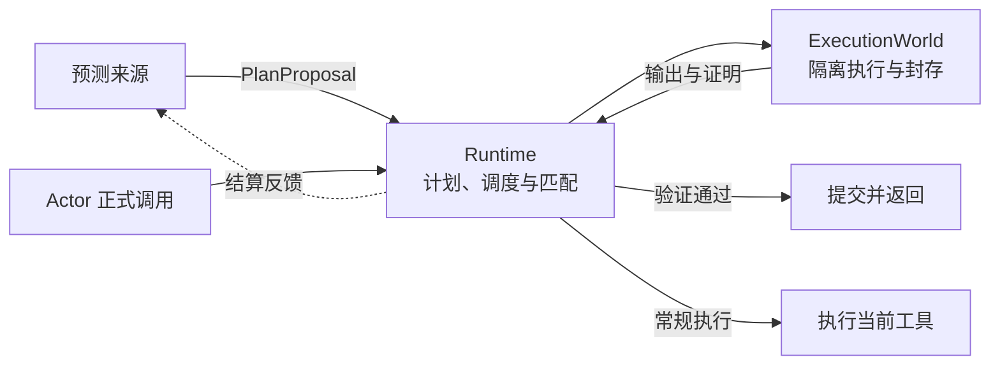

# Pi 投机执行

通过 Pi 扩展接口接入的工具投机执行系统：在 Actor（执行当前任务的模型）发出正式工具调用前，预测后续动作并提前执行；调用到达后，验证并采纳已有计算。项目围绕三个部分组织：预测计划、统一 Runtime、隔离执行后端。

## 工作流程



预测来源统一生成带依赖关系的 `PlanProposal`，可随执行结果继续扩展。Runtime 按 Actor 决策进度推进计划，根据依赖、启动窗口和实时资源安排准备与执行。同一 Runtime 的各会话共用调度器，准备、投机执行与真实调用共用资源账本，Actor 优先。

正式调用通过动作键和投影规则查找候选：可以采用完整或覆盖当前请求的结果，也可以在封存的固定输入版本上按当前参数重新求值。流式调用预览按同一流程验新并准备当前查询，保留结果、证明和计算回执；正式调用再次验新后采纳。已绑定动作的准备工作、排队候选和在途执行均可交给 Actor 继续推进，直至完成或接续其进程；取消、执行失败和输入失效按生命周期处理。

匹配负责发现候选，采纳以执行器兼容、权限与作用域有效、实际依赖与记录版本一致为前提。提交前的验证负责选择采纳结果或按当前绑定执行工具。效果采用单次提交语义；发生部分提交或效果状态待核实的错误时，本次调用随即终止。

## 代码模块

| 模块 | 主要源码 | 职责 |
| --- | --- | --- |
| Pi 接入 | [extension.ts](./src/extension.ts)、[agent-integration.ts](./src/agent-integration.ts) | 注册扩展与设置菜单，接收模型流和工具调用，连接 Host、Runtime 与执行后端。 |
| 预测来源 | [drafter-plan-source.ts](./src/drafter-plan-source.ts)、[pattern-plan-source.ts](./src/pattern-plan-source.ts)、[actor-fork-plan-source.ts](./src/actor-fork-plan-source.ts) | 将模型预测、历史模式和可选 Actor 探测转换为统一计划，供 Runtime 调度和反馈。 |
| 计划与调度 | [plan-runtime.ts](./src/plan-runtime.ts)、[scheduler.ts](./src/scheduler.ts)、[system-resources.ts](./src/system-resources.ts) | 推进依赖与预测窗口，依据实时资源、调用需求和置信度安排工作，处理争用与抢占。 |
| 候选与采纳 | [runtime-engine.ts](./src/runtime-engine.ts)、[action-semantics.ts](./src/action-semantics.ts)、[candidate-stores.ts](./src/candidate-stores.ts) | 管理会话、动作身份、候选索引、结果和输入借用；完成匹配、等待、验证与结算。 |
| 执行协议 | [execution-world.ts](./src/execution-world.ts)、[effect-transaction.ts](./src/effect-transaction.ts)、[runtime-lifecycle.ts](./src/runtime-lifecycle.ts) | 统一后端能力、分支提交状态，以及在途任务和资源的关闭排空。 |
| 度量 | [settlement.ts](./src/settlement.ts)、[task-timing.ts](./src/task-timing.ts)、[trace-summary.ts](./src/trace-summary.ts) | 区分预测、执行与实际采纳，按计算来源汇总复用量、工具等待和诊断事件。 |

根入口导出 [Pi Host API](./src/index.ts)；[`./core`](./src/core.ts) 提供可独立使用的 Runtime，[`./process-reuse`](./src/process-reuse.ts) 提供进程证明、规划和存储接口。新增预测来源实现 `SpeculativePlanSource`；新增后端实现 `ExecutionWorld`，通过 Host 的 `executionWorlds` 注册。宿主负责在结束时调用 `host.dispose()`。

## 执行方案

各后端遵循同一协议：`ExecutionWorld` 提供执行或观察能力，一次执行返回 `WorldBranch`，封装输出、依赖证明、可提交效果和资源释放方法；`EffectTransaction` 管理验证与采纳状态。后端可额外提供封存输入与查询能力，使不同工具或参数复用已有输入计算。通过能力检查的执行路线可以提前执行。

自定义工具通过 `bindResourceOperation(execute, root)` 显式选择共用文件操作回调，或通过 `ToolInvocation.filesystem`、`captureInputs`、`ProcessExecutionCoordinator` 提供绑定；`ExecutionWorld.observeOperations` 可独立观察调用，即使整工具没有动作键。共享输入和子计算按实际依赖、效果与所有权查找和验新，工具名称不限制复用；运行时才发现的路径也能查询现有资源。生产者退出当前工具集后，已经运行的工作与已完成资源继续由原有所有权和预算管理，尚未启动的预测重新检查可用工具。`ToolFilesystemOperations.prepare` 以共享绑定和计算键借用已完成子计算；可选资源路径仅作索引提示，无路径的计算也可被其他工具发现。`bindResourceOperation` 让正常 Actor 执行也保留实际输入、写入后的内容和纯子计算；消费前在借用生命周期内精确验新，失败的消费不会重放效果，预算不足或超出共享根仍按原生操作完成。构建器只通过给定视图读取依赖，绑定和计算键须覆盖其他输入，共享值保持不可变。消费工具继续执行自己的格式化与剩余操作。原生子计算携带后端签发的独立效果契约，准备时仍检查当前父调用权限；整段宿主函数的隔离仍需明确绑定完整执行出口。未接入操作出口的第三方函数需要宿主提供绑定。

| 实现 | 方法与边界 |
| --- | --- |
| [封存资源](./src/agent-execution-world.ts) / [输入版本](./src/resource-version.ts) | 为绑定的文件工具捕获实际访问的数据，保留内容与路径证明；后续查询复用仍有效的输入，并对本次使用的依赖精确验新。受控 `find/grep` 由 [统一工具绑定](./src/pi-tool-invocation.ts) 让 Actor 与投机使用相同执行器，需显式启用。 |
| [私有工作区](./src/workspace-sandbox.ts) / [文件事务](./src/workspace-transaction.ts) | 普通 `write/edit` 先在内存事务中执行；需要私有分支时使用 Git 或通过检查的 OverlayFS。文件效果在持锁状态下验证并提交，多步计划可沿私有分支继续执行。 |
| [Linux 进程](./src/linux-process-world.ts) / [进程后端](./src/linux-process-backend.ts) | 用 Sandlock 隔离执行、strace 记录依赖和效果，再通过证书验证。合格的 x86-64 Linux 使用 [held-exec](./src/linux-held-exec.c) 接管已完成计算，或在支持的系统调用入口转移单线程进程、继续执行后缀。可证明等价的结果在输入与证明记录一致、生命周期有效时反复复用；含时钟、随机或进程身份等观测的结果采用一次性交接。 |
| [ThinkThread](./src/thinkthread/execution-world.ts) | 通过固定 SDK 的快照与 `fs.run` 接入相同分支协议，文件读取可进入公共封存输入层。默认覆盖 `read/ls/write/edit`；`bash/find/grep` 由 Actor 的原生工具执行。 |

结果、输入和进程句柄分别保留自己的所有权；跨轮复用以作用域与新鲜度证明为依据。独立子步骤凭自身证明即可采纳；提交后，后续工作区分支以真实状态为基线。候选库变化和临时占用释放会唤醒等待者重新选取，等待期间新增的结果也参与匹配。每次请求都依据自身证明决定采纳；提交失败后，已确认本次操作保持或恢复原有状态的请求可重新验新并重试。各条证书和产物独立验证与筛选，新发布的正确内容可修复损坏副本。已封存结果跨轮保留，采纳时按实际依赖精确验新。共享缓存目录通过跨进程事务协调发布和逐对象回收，有限的发布事务保护产物写入到证书封存的全过程；失败发布回滚元数据，统计按需清点实际文件及崩溃残留。存储打开期间周期回收覆盖一次性交接、继续执行和中途失败留下的孤立产物，按宽限期清理并在临时失败后重试。活跃交接结果独立持有证书、完整计算图、已验证产物与继续执行映像，并和调用参数共用保留预算；容量按序列化证据和载荷字节核算，预算淘汰避开正在借用的结果，释放后重新收敛。已有缓存通过独立只读连接查询已提交历史，排队与锁等待支持取消并设一秒接纳预算；尚未接纳的调用到期即可退出，接纳后的写入安全收尾再释放事务。依赖验新逐块观察取消，存储关闭等待整个查找及其文件句柄清理。单个等待者退出不会取消共享初始化；路由所有者关闭会终止并回收探测，探测进程另设十秒超时。旧缓存自动迁移，迁移提交完成后再清理旧文件。回收期间新发布或重新引用的对象保留到下一轮，容量允许短暂超额。关闭会话先停止新操作与锁等待，再排空已接纳工作并释放资源。直接使用 process-reuse API 时，以 `withPublication` 包住产物写入至证书封存，在回调外调用 `gc`、`drain` 或 `dispose`。

## 使用

```sh
pi install https://github.com/xchang1121/pi-speculative-action
# 或加载本地 checkout
pi -e /absolute/path/to/pi-speculative-action
```

版本与依赖见 [package.json](./package.json)。在 Pi 中运行 `/speculative-action`，开启投机、选择预测来源和工具后 **Apply changes**；在 **Tools & execution → Execution routes** 检查实际可用的后端。配置保存在 `<agent-dir>/speculative-action.json`，项目的 `.pi/speculative-action.json` 可覆盖全局设置。

Linux / WSL 2 的 Bash 后端可从菜单检查和安装，也可在源码目录运行 `npm run setup:linux`；WSL checkout 应放在 Linux 原生文件系统。原生进程自动选用合格的 OverlayFS，回退 Git 时补齐空目录和权限；两条路径中被复制的原始对象通过持有对象和元数据映射，保持路径、文件描述符及目录枚举所见身份一致，采纳前仍精确验新。ThinkThread 使用独立的 [Profile 安装脚本](./scripts/install-thinkthread-profile.sh)，安装后在项目中运行 `tt pi-speculative-action`。Actor 常规执行承担基础工具调用，各后端在满足可用条件时承接投机工作。

## 开发与验证

```sh
npm ci
npm run check
npm run build
npm test -- --maxWorkers=1 --no-file-parallelism
npm run bench:check
```

[test](./test) 以系统功能测试为主：真实 Pi 会话、文件读写与跨轮工作流、Linux 原生进程接管、磁盘缓存重开和 HTTP/socket 通信。模型回复使用确定性脚本；系统测试以交付结果、复用与副作用作为断言依据，计时数学另用少量单元测试验证。Linux 用例需要已安装的原生后端；ThinkThread 本地 wire runner 与控制协议测试覆盖本地传输行为，真实 Runtime 资格需通过实机流程验证。[验证说明](./bench/README.md) 列出后端资格、完整模型任务和计量规则。

`toolSpeedup = T / (T - H)` 采用乐观执行边界口径：T 为本次调用实际消费的执行区间，含首次证明、封存及生产者在调用后继续完成的计算；H 为其中实际复用且在 Actor 发出调用前完成的部分。工具计算和接管控制分开计量，`adoptionWaitMs` 单列纯协调等待。该比值描述工具执行区间的复用收益；CPU 使用与任务端到端净收益通过独立测量评估。
