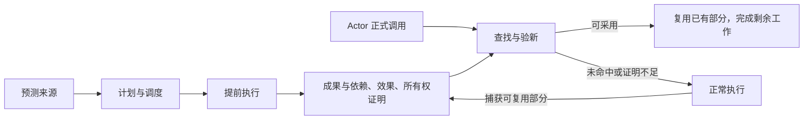

# Pi 投机执行与缓存复用

纯 Pi 扩展：提前执行可能需要的工作，让正式工具调用复用已经完成的部分，保留原工具的输出和副作用语义。

## 主线架构

**投机决定提前做什么，缓存复用决定已有工作能否使用。** 两者由同一运行时编排；缓存既接收投机产物，也接收正常执行留下的可复用成果。



- **投机生产**：Drafter、PatternAware 和 Actor 信号提供候选，计划与调度负责依赖、预算、并发和取消，执行后端负责受控执行。提前准备已观察的子操作也属于这一层。预测观测只用于私有续推，Actor 历史只接收真实结果。
- **缓存复用**：保存、发现并验证工具结果、输入、纯子计算及受支持的进程状态。正式调用按实际操作、依赖、效果和当前所有权采用成果，继续执行剩余部分；工具名称和预测来源不授予复用权限。

预测匹配、成果有效性和实际消费分别记账。关闭投机后，正常调用仍可积累并使用缓存；预测失配也不自动作废独立有效的成果。效果只提交一次，消费期间保留资源，取消、淘汰和关闭按所有权释放。收益只计实际消费的计算，等待和未消费的工作另行统计。

源码主线：[Host 接入](./src/agent-integration.ts) → [运行时编排](./src/runtime-engine.ts) → [统一执行入口](./src/tool-execution-gateway.ts)。[执行世界](./src/execution-world.ts)提供捕获、验证和提交契约；[资源版本](./src/resource-version.ts)与[存储](./src/reuse-store.ts)管理可复用成果及证明。

## 使用

需要 Node.js ≥ 22.19；使用未修改的 Pi，当前兼容验证基线为 `0.84.1`。

```sh
pi install git:github.com/xchang1121/pi-speculative-action@speculative-action
pi
```

运行 `/speculative-action`，调整开关和预测来源后选择 **Apply changes**。

| 开关 | 默认值 | 职责 |
| --- | --- | --- |
| **Speculative production** (`enabled`) | 关闭 | 启用额外的提前生产，包括调用预测、流式预览和已观察操作的准备。 |
| **Cache & reuse** (`reuseEnabled`) | 开启 | 捕获并采用可复用成果；关闭后停止缓存采用及新的提前生产。 |

两个开关都保留实际调用的观察与模式学习。`tools` 和各预测来源开关只筛选提前生产，不限制其他工具复用合格成果。

全局配置位于 `<agent-dir>/speculative-action.json`，项目配置位于 `.pi/speculative-action.json`。安装准备阶段使用随依赖保留的 TypeScript 编译器生成入口，兼容 Pi 默认省略开发依赖的 Git 安装；类型检查在开发验证阶段单独运行。Pi 加载已编译入口；本地修改源码后运行 `npm run build`，再用 `pi -e /absolute/path/to/pi-speculative-action` 加载。

Linux / WSL 2 需在扩展目录运行 `npm run setup:linux`，升级后重新运行；WSL checkout 放在 Linux 原生文件系统。Windows x64 使用随包提供的本地 NTFS 对象租约，无需另行编译。

Linux 的透明子进程观察还需要合格的观察助手：通过 `PI_SPEC_HELD_EXEC_OBSERVER` 指向管理员部署、普通用户不可修改且具有 `CAP_SYS_PTRACE` 的独立 `.observer` 文件。助手核对调用者及目标进程身份，并在附着后释放该能力；工作负载本身不获得此权限。若启动环境已经设置 `no_new_privs`，助手也可在该约束下工作，但这会阻止依赖提权的 FUSE 挂载，不能用作完整验证环境的通用替代。权限不足时原工具正常执行，透明复用不可用。
Linux 进程复用统一要求 cgroup v2、内核 BTF 与所需 eBPF tracing/kprobe hooks、`bpf_loop`；构建采集器还需要 Clang 和 libbpf、libelf、zlib 开发库。安装后，保留上面配置的观察助手，通过前台执行域启动 Pi：

```sh
sudo ~/.local/bin/pi-speculative-domain --user "$(id -u)" env \
  PATH="$PATH" PI_SPEC_HELD_EXEC_OBSERVER="$PI_SPEC_HELD_EXEC_OBSERVER" "$(command -v pi)"
```

执行域负责对象版本、描述符身份、元数据观察和进程回收，Pi 与工具仍以原用户运行；进程接管、资源所有权、效果提交和计量沿用现有执行世界。仅配置旧观察助手已不足以启用 Linux 进程复用；普通启动或内核条件不足时，工具照常执行，文件输入和纯计算仍按各自能力工作。

同一采集器共享已加载的观察探针，执行结束只释放其借用；最多保留 256 个探针对象，容量满时淘汰空闲对象，退出时统一关闭。执行域最多同时持有 256 个观察所有者，稀疏的内核对象表按需分配，各有 65,536 条上限；分配失败、溢出、丢失或观察中断使相关证明失效，不能以不完整证据交付资源。重新启动执行域可重新建立观察代际。

## 支持边界

资格由实际操作、依赖、效果和所有权决定。下表描述可验收的能力；某个工具名称或“只读”声明不会授权缓存其完整结果。

| 能力 | 成立条件与不满足时的行为 | 公开入口验收 |
| --- | --- | --- |
| 共享输入、纯子计算 | 实际操作绑定、有效依赖证明；可跨工具消费，缺少绑定或证明时正常执行。 | `agent.system`、`persistent-inputs` |
| 工作区效果 | 私有工作区隔离、验新、事务提交及所有权释放；提交前失效可回退，已产生效果且恢复不明时终止。 | `process-reuse.system`、`host-closure`、`linux-overlayfs` |
| Linux 完成成果与进程接管 | 已验证 x86-64、同一 ext4 挂载、合格 Bash 分支、已观察子操作及可封存的单线程进程；需要当前构建的执行域、观察助手和通过行为探测的后端。缺少执行域时进程复用不可用。 | `extension.system`、`linux-reuse-chain`、`held-exec` |
| 检查点跨进程恢复 | 另限同一次系统启动、同一 Pi 会话、工作区和原缓存位置；身份、输入、所有权或镜像不符时拒绝恢复。 | `process-reuse.system` |
| Windows | 本地 NTFS 文件资源与私有工作区；没有 Linux 同等进程接管能力。 | `filesystem-lease`、`host-closure` |

进程观察根允许空格、反斜杠和 UTF-8 字符；须为规范化后的绝对目录、归调用者所有且组/其他用户不可写。路径须小于 Linux `PATH_MAX`（4,096 字节），每条祖先链最多 64 项（包括根自身和 `/`），同一观察所有者最多 4 个根、64 个去重父目录。限额耗尽或权限不符会给出具体拒绝原因。`linux-environment` 验证诊断与真实准入一致，`extension.system` 验证这些路径下的实际消费。

菜单中的 **Check Linux environment** 使用运行时同一执行域握手、工作区准入及观察助手探测，分别列出构建条件、当前缺口和未验证事项；**Refresh and show capabilities** 显示已启用后端的实际资格。构建工具或库存在并不等于操作已获复用资格。升级后须重新 `setup:linux` 并重启前台执行域；仅保留旧观察助手不能恢复进程复用。

任意原生程序、多线程续接、任意外部副作用、宿主中断工具批次的透明恢复及外部 runtime world 尚不支持。Linux 实测环境为 WSL 2 / Ubuntu 24.04、x86-64 和原生 ext4，不外推其他内核、文件系统或架构。上表用例位于 `test/`，平台专属跳过不计为支持证据。

验新不提供任意外部并发写入的隔离保证。证明不足时沿原路径执行；若提交已产生副作用且无法证明恢复，则报错终止，避免重复执行。

## 开发

```sh
npm ci
npm run check
npm run build
npm test -- --maxWorkers=1 --no-file-parallelism
npm run bench:check
```

Windows 开发可在 WSL 中运行 `scripts/wsl-verify.sh`。它将当前提交和未提交改动复制到独立 Linux checkout，构建私有助手，再通过 `sudo` 启动该构建的前台执行域；测试仍以原用户运行。先按上文配置 `PI_SPEC_HELD_EXEC_OBSERVER`，脚本不安装持久服务或替换用户助手。

扩展接口见 [Pi Host API](./src/index.ts)、[core](./src/core.ts) 和 [process-reuse](./src/process-reuse.ts)。新预测来源提交计划，新执行后端实现执行世界契约；反馈通过 `runtime.subscribe()` 接收，结束时调用 `host.dispose()`。

[验证与收益口径](./bench/README.md) · [变更记录](./CHANGELOG.md)
